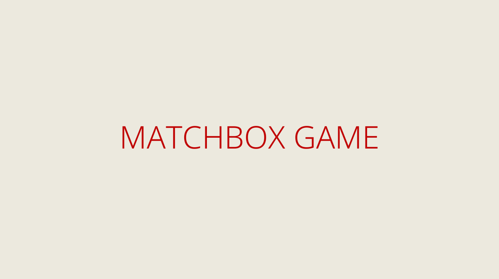
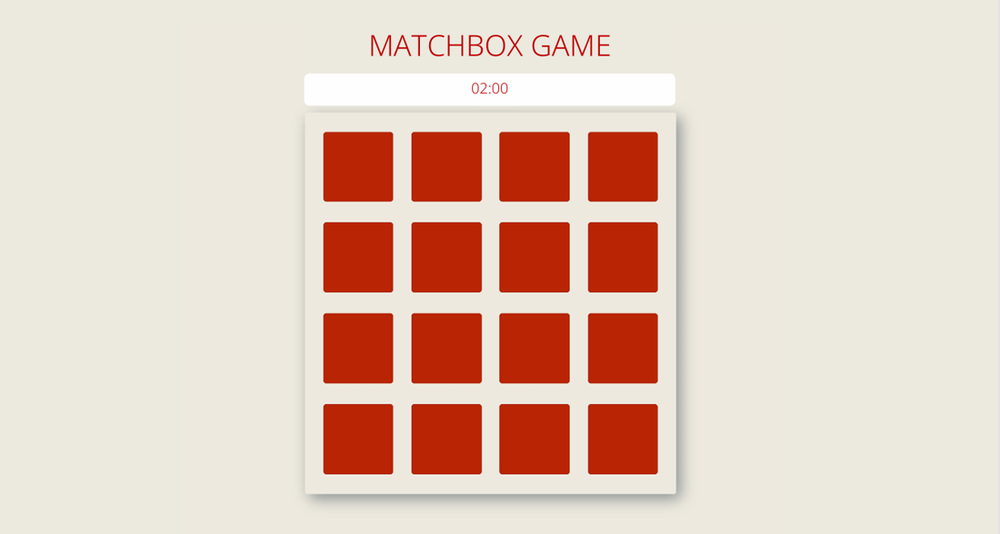
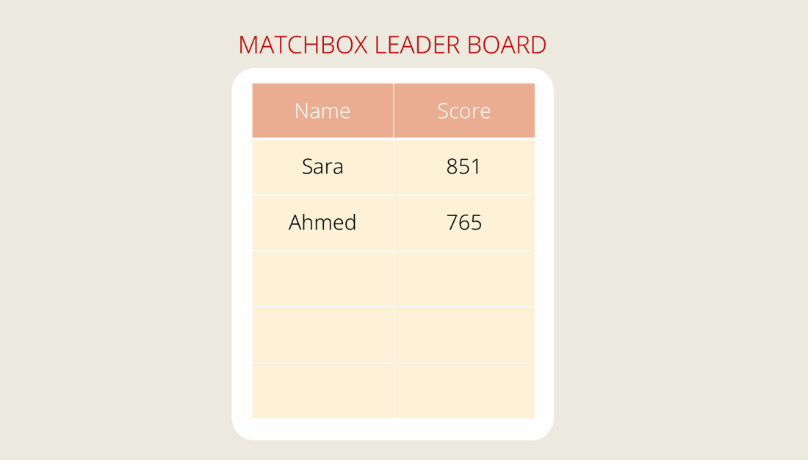

# Memory Match Game

A timed card-matching game for events and exhibitions, with a live leaderboard.

## How it works
1. Player enters their name and taps Start.
2. A 4x4 grid of face-down cards appears with a 2:00 countdown.
3. Flip two cards at a time; matching pairs stay open.
4. Score is based on how fast all pairs are matched.
5. The result is saved to a leaderboard shown on a big screen.

| Game board | Leaderboard |
|---|---|
|  |  |

## Features
- Countdown timer and speed-based scoring
- Works on desktop, tablet and phone browsers
- Live leaderboard for kiosk or big-screen display
- Card images and colours are easy to re-theme

## Tech
HTML, CSS, JavaScript, ASP.NET backend for score storage.

## Status / access
Built for live events. Source code is private; available on request.
